# MASTER SYSTEM SPECIFICATION: OMNIWAREHOUSE
**Platform Manajemen Pergudangan Universal Dual-Platform Berbasis Multi-Tenant (SaaS-Ready)**

---

| Informasi Proyek | Detail Spesifikasi |
| :--- | :--- |
| **Nama Proyek** | OmniWarehouse: Universal Inventory & Warehouse Management Platform |
| **Tim Pengembang** | Team D Software Internship (Afgan, Dzulfikar, Damar, Kayla) |
| **Supervisor / Mentor** | Andika Prasetiawan |
| **Periode Pengembangan** | September 2026 – Desember 2026 (Agile 8 Sprint) |
| **Status Dokumen** | **Living Master Specification (Single Source of Truth)** |
| **Dokumen Referensi Awal** | `docs/references/` (`prd.md`, `user-stories.md`, `erd.md`, `workflow.md`) |

---

## DAFTAR ISI
1. [BAB 1: Konteks Proyek & Masalah Bisnis](#bab-1-konteks-proyek--masalah-bisnis)
2. [BAB 2: Arsitektur Sistem & Realitas Tech Stack](#bab-2-arsitektur-sistem--realitas-tech-stack)
3. [BAB 3: Arsitektur Multi-Tenancy & Matriks Peran (RBAC)](#bab-3-arsitektur-multi-tenancy--matriks-peran-rbac)
4. [BAB 4: Alur Kerja Operasional Utama (Core Workflows)](#bab-4-alur-kerja-operasional-utama-core-workflows)
5. [BAB 5: Spesifikasi Fitur Dual-Platform (Web Console vs Mobile App)](#bab-5-spesifikasi-fitur-dual-platform-web-console-vs-mobile-app)
6. [BAB 6: Mekanisme True Offline-First & Kontrak API](#bab-6-mekanisme-true-offline-first--kontrak-api)
7. [BAB 7: Artefak Dokumen Cetak, Label Barcode & Pelaporan](#bab-7-artefak-dokumen-cetak-label-barcode--pelaporan)
8. [BAB 8: Kebutuhan Non-Fungsional (NFR) & Metrik Pengujian](#bab-8-kebutuhan-non-fungsional-nfr--metrik-pengujian)
9. [BAB 9: Status Audit Pengembangan Riil & Sprint Roadmap](#bab-9-status-audit-pengembangan-riil--sprint-roadmap)

---

## BAB 1: Konteks Proyek & Masalah Bisnis

### 1.1 Latar Belakang Masalah Lapangan
Operasional pergudangan konvensional menghadapi tantangan kritis yang menghambat efisiensi rantai pasok:
1. **Area *Blank Spot* Sinyal:** Bangunan gudang berdinding beton tebal dan beratap baja sering kali memutus koneksi internet. Aplikasi WMS cloud murni sering mengalami *freeze* atau gagal transaksi saat staf bekerja di lorong terdalam.
2. **Antarmuka Rumit (*Form-Heavy UI*):** Staf lapangan yang membawa barang fisik kesulitan mengisi puluhan kolom form di layar kecil, memperlambat proses *inbound* dan *outbound*.
3. **Visibilitas Stok Terfragmentasi:** Data stok antar-gudang dan antar-rak terpisah-pisah, memicu selisih stok (*discrepancy*) antara catatan komputer dan barang fisik di rak.
4. **Jejak Audit Lemah (*Weak Traceability*):** Mutasi dan perpindahan barang tidak tervalidasi secara digital, menyulitkan pelacakan pihak yang bertanggung jawab atas kehilangan atau kerusakan barang.

### 1.2 Visi & Solusi Dual-Platform
OmniWarehouse menyelesaikan masalah di atas dengan pendekatan **Dual-Platform SaaS-Ready**:
* **Web Console (Manajerial & Pengawasan):** Ditujukan untuk Administrator Gudang, Supervisor, dan Manajemen Finance. Fokus pada pengaturan master data terpusat, analitik nilai persediaan real-time (*Valuation*), approval transaksi, dan manajemen sesi audit.
* **Mobile App (Eksekusi Cepat di Lapangan):** Ditujukan untuk Staf Operasional Gudang. Mengusung konsep **Plain UI** berbasis pemindaian Barcode/QR yang berjalan dengan prinsip **True Offline-First** (dapat beroperasi penuh tanpa sinyal internet).

---

## BAB 2: Arsitektur Sistem & Realitas Tech Stack

### 2.1 Realitas Arsitektur Kode (Codebase Reality)
Sistem ini menggunakan arsitektur monolit modern yang efisien pada Web Console, sekaligus bertindak sebagai API Gateway untuk Mobile Application:

```mermaid
graph TD
    subgraph Mobile Layer [Staf Operasional Lapangan]
        MobileApp["Flutter Mobile App (Dart)"]
        SQLite[("Local SQLite Database")]
        WorkManager["WorkManager (FIFO Queue Engine)"]
        Scanner["Camera Barcode / ML Kit Scanner"]
        MobileApp <--> SQLite
        SQLite --> WorkManager
        Scanner --> MobileApp
    end

    subgraph API Gateway & Authentication
        Sanctum["Laravel Sanctum (Token Auth API)"]
        RateLimiter["Rate Limiting & Tenant Validator"]
    end

    subgraph Web Console Layer [Manajemen & Supervisor]
        WebBrowser["Web Browser (React 19 + TypeScript)"]
        Inertia["Inertia.js Monolith Bridge"]
        Tailwind["Tailwind CSS UI + Lucide Icons"]
        WebBrowser <--> Inertia
    end

    subgraph Backend Core [Laravel 12 Application Core]
        RoutesWeb["Routes /web.php (Tenant Slug Routing)"]
        RoutesApi["Routes /api.php (REST API)"]
        Controllers["Tenant & Admin Controllers"]
        SpatieRBAC["Spatie Permission (RBAC Engine)"]
        PDFExcel["DomPDF & Laravel Excel Exporter"]
    end

    subgraph Database Layer [Pusat Data Terisolasi]
        PostgreSQL[("PostgreSQL 16 Database")]
        TenantsTable[("Multi-Tenant Schemas & Tables")]
        PostgreSQL --- TenantsTable
    end

    WorkManager -- "REST API /api/* (JSON + Bearer Token)" --> Sanctum
    Sanctum --> RoutesApi
    RoutesApi --> Controllers

    Inertia <--> RoutesWeb
    RoutesWeb --> Controllers

    Controllers --> SpatieRBAC
    Controllers --> PDFExcel
    Controllers <--> PostgreSQL
```



### 2.2 Komponen Teknologi Aktual
* **Web Console & Backend:**
  * Framework: **Laravel 12.x** (PHP 8.3+)
  * Frontend: **Inertia.js v3.0** dengan **React 19** & **TypeScript**
  * Styling & UI: Tailwind CSS, Radix UI Primitives, Lucide Icons
  * RBAC Engine: `spatie/laravel-permission` (Role & Permission dinamis per tenant)
  * Reporting: `barryvdh/laravel-dompdf` (Cetak Surat Jalan & PDF) & `maatwebsite/excel` (Ekspor Excel)
* **Mobile Client:**
  * Framework: **Flutter (Dart)**
  * Local Storage: **SQLite** (`sqflite` / `drift`)
  * Background Task: **WorkManager** (Auto-sync saat sinyal pulih)
  * Scanner: **Google ML Kit Barcode Scanning**
* **Database Pusat:**
  * Engine: **PostgreSQL**
  * Multi-Tenancy Strategy: Single Database with Column-Level Tenant Isolation (`tenant_id`).

---

## BAB 3: Arsitektur Multi-Tenancy & Matriks Peran (RBAC)

### 3.1 Model Isolasi Multi-Tenant
Aplikasi mendukung sistem Software-as-a-Service (SaaS) dengan pembagian dua tingkat hak akses:
1. **Tingkat Central / Platform:**
   * Diperuntukkan bagi pengelola platform (Superadmin).
   * URL Akses: `/dashboard`, `/tenants`, `/plans`, `/subscriptions`.
   * Model data: `tenant_id = null`.
2. **Tingkat Tenant (Penyewa Platform / Perusahaan Logistik):**
   * Diperuntukkan bagi perusahaan penyewa dengan isolasi data ketat via kolom `tenant_id`.
   * URL Web: `/{tenant_slug}/...` (misal: `/demo-tenant/dashboard`).
   * API Mobile: Header / Request Body menyertakan `workspace_slug`.

### 3.2 Matriks Hak Akses Peran (Role Matrix)

| Modul / Kemampuan | Superadmin (Central) | Admin Gudang (Tenant) | Supervisor Gudang | Staf Lapangan (Operator) |
| :--- | :---: | :---: | :---: | :---: |
| **Akses Platform** | Web Console | Web Console | Web Console & Mobile | Mobile App Only |
| **Kelola Tenant & Paket Langganan** |  Ya |  Tidak |  Tidak |  Tidak |
| **Master Data (Produk, SKU, Gudang, Rak)** |  Tidak |  Penuh (CRUD) |  Lihat Saja (Read) |  Tidak |
| **User & Role Tenant Management** |  Tidak |  Ya |  Tidak |  Tidak |
| **Inbound & Outbound Order Creation** |  Tidak |  Ya |  Ya |  Tidak |
| **Inbound & Outbound Physical Scan** |  Tidak |  Tidak |  Ya |  Penuh (Offline-First) |
| **Approval Transaksi & Surat Jalan** |  Tidak |  Ya |  Penuh (Approval) |  Tidak |
| **Stock Transfer & Handover** |  Tidak |  Lihat & Setujui |  Approval Mutasi |  Eksekusi Scan & GPS |
| **Buka Sesi Stock Opname** |  Tidak |  Ya |  Penuh |  Tidak |
| **Eksekusi Blind Count Opname** |  Tidak |  Tidak |  Ya |  Penuh (Offline Scan) |
| **Discrepancy Reconciliation & Adjustment** |  Tidak |  Lihat |  Penuh (Approval) |  Tidak |
| **Dashboard Valuasi Aset & Audit Trail** |  Tidak |  Penuh (Export) |  Lihat Saja |  Tidak |

---

## BAB 4: Alur Kerja Operasional Utama (Core Workflows)

### 4.1 Inbound Receiving (Barang Masuk)
* **Happy Path:**
  1. Supervisor membuat Purchase Order / Rencana Penerimaan di Web Console.
  2. Staf Gudang membuka Mobile App (bisa offline) -> memilih menu Inbound.
  3. Staf memindai Barcode/QR kemasan barang -> memindai Barcode Rak tujuan.
  4. Staf mengisi jumlah fisik yang diterima beserta Batch Number / Expiry Date (jika ada).
  5. Transaksi tersimpan di lokal (SQLite). Saat online, transaksi disinkronkan ke PostgreSQL.
* **Unhappy Path (Barang Rusak / QC Triage):**
  * Jika kemasan barang rusak atau isi cacat, staf menandai item sebagai *"QC Rejected / Karantina"*.
  * Stok otomatis masuk ke Lokasi Rak Khusus Karantina (`is_active = false` atau area Triage) dan tidak menambah stok siap jual.

### 4.2 Outbound & FEFO Picking (Barang Keluar)
* **Happy Path:**
  1. Admin/Supervisor menerbitkan Sales Order / Picking List di Web Console.
  2. Mobile App memberikan instruksi navigasi **FEFO (First Expired, First Out)**: mengarahkan staf ke rak yang memiliki barang dengan *expiry date* terdekat.
  3. Staf mendatangi rak, memindai Barcode Rak dan Barcode Barang untuk validasi akurasi ambil.
  4. Sistem memverifikasi kecocokan barang dan memotong stok.
  5. Web Console mencetak dokumen **Surat Jalan / Delivery Order**.
* **Unhappy Path (Stok Rak Fisik Kurang):**
  * Jika barang di rak kosong/rusak, staf memilih opsi *"Short Pick / Stok Tidak Cukup"*.
  * Sistem memicu notifikasi selisih (*Alert*) ke Supervisor dan merekomendasikan rak alternatif.

### 4.3 Mutasi Stok & Handover (Stock Transfer)
1. **Pengajuan:** Permintaan transfer barang antar-rak atau antar-gudang diajukan di Web/Mobile.
2. **Pengeluaran:** Staf pengirim memindai barang yang dikeluarkan dan men-generate QR Penyerahan.
3. **Penerimaan & Bukti Fisik:** Staf penerima memindai QR penyerahan, mengambil **foto kondisi barang fisik**, dan sistem secara otomatis merekam titik koordinat **GPS Geotagged**.
4. Saldo stok berpindah secara sah di sistem.

### 4.4 Blind Stock Opname & Penyesuaian Selisih
1. **Buka Sesi:** Supervisor membuka sesi Stock Opname di Web Console untuk zona atau gudang tertentu.
2. **Blind Count (Pencatatan Buta):** Staf berkeliling memindai seluruh fisik barang di rak menggunakan Mobile App **tanpa diperlihatkan jumlah stok menurut sistem** (menghindari kecurangan audit).
3. **Rekonsiliasi Selisih:** Sistem membandingkan data hitungan fisik vs data sistem.
4. **Approval Adjustment:** Supervisor mengevaluasi laporan selisih (*Discrepancy Report*). Jika disetujui, stok disesuaikan secara otomatis dan tercatat permanen di *Audit Trail Log*.

---

## BAB 5: Spesifikasi Fitur Dual-Platform (Web Console vs Mobile App)

### 5.1 Kemampuan Web Console (Manajemen & Analitik)
* **Katalog Master Data:** Manajemen Produk, Multi-SKU, Kategori, Unit (Pcs, Box, Kg), Mitra (Customer & Supplier).
* **Multi-Warehouse & Denah Rak:** Manajemen banyak gudang fisik dan struktur hierarki rak (Zona, Lorong, Rak, Bin).
* **Single Table Inventory:** Tampilan inventaris terpusat dengan filter instan berdasarkan SKU, lokasi rak, nomor batch, dan status stok.
* **Laporan Real-time Valuation:** Kalkulasi otomatis total nilai aset barang persediaan berdasarkan harga pokok beli aktual (*Cost of Goods*).
* **Immutable Audit Trail:** Catatan histori log transaksi yang bersifat *Read-Only* (tidak bisa dihapus/diedit) untuk kebutuhan audit kepatuhan.

### 5.2 Kemampuan Mobile App (Kecepatan Operasional Lapangan)
* **Plain UI Ergonomis:** Navigasi ringkas dengan tombol aksi cepat (Scan Barcode, Status Sinkronisasi).
* **Barcode Scanner Engine:** Pemindaian kamera ultra-cepat menggunakan Google ML Kit.
* **Indikator Sinyal & Antrean:** Widget visual yang menunjukkan status koneksi (Online/Offline) dan jumlah antrean data yang belum tersinkronisasi di SQLite.
* **Tracking Detail Capture:** Input nomor seri (*Serial Number*), *Batch Number*, dan *Expiry Date*.

### 5.3 Modul R&D / Eksplorasi Masa Depan (Phase 3)
* **AI Voice Command:** Pengenalan instruksi suara hands-free (contoh: *"Masuk 10 box Kopi Arabika di Rak A2"*). Status: Studi kelayakan / fitur opsional lanjutan.
* **AI OCR Fallback:** Pemindaian nomor seri fisik yang tergores menggunakan OCR teks otomatis. Status: Fitur pendukung saat barcode fisik rusak.

---

## BAB 6: Mekanisme True Offline-First & Kontrak API

### 6.1 Alur Simpan & Sinkronisasi Data (WorkManager FIFO)
1. **Offline Mode:** Saat berada di area tanpa sinyal, transaksi dibuat di perangkat mobile dan langsung disimpan ke tabel lokal SQLite.
2. **Identitas Unik:** Setiap transaksi lokal dibekali kode `local_uuid` dan *high-precision timestamp*.
3. **Background Auto-Sync:** Segera setelah perangkat mendeteksi jaringan internet, **WorkManager** mengeksekusi antrean pengiriman data secara berurutan (*First In, First Out*) ke endpoint API backend.
4. **Indikator Nol:** Setelah respons `200 OK` diterima dari server, antrean lokal ditandai terkirim dan indikator kembali ke nol.

### 6.2 Strategi Penanganan Konflik Data (Conflict Resolution)
* **Idempotency Check:** Server Laravel memeriksa nilai `local_uuid`. Jika UUID transaksi sudah pernah tercatat di PostgreSQL, server menolak duplikasi tanpa memicu error (*Safe Retry*).
* **Timestamp Precedence:** Jika terjadi dua transaksi pada stok yang sama di saat offline, server mengurutkan mutasi berdasarkan waktu terjadinya transaksi (*Event Timestamp*), bukan waktu tibanya paket di server.

### 6.3 Kontrak Endpoint API Mobile (Sanctum)

#### 1. Validasi Workspace Tenant
* **Endpoint:** `POST /api/verify-tenant`
* **Request Payload:**
  ```json
  {
    "workspace_slug": "demo-tenant"
  }
  ```
* **Response (200 OK):**
  ```json
  {
    "message": "Workspace tervalidasi.",
    "data": {
      "tenant_id": 1,
      "name": "PT Demo Logistik",
      "slug": "demo-tenant"
    }
  }
  ```

#### 2. Autentikasi Pengguna & Penerbitan Token
* **Endpoint:** `POST /api/auth/login`
* **Request Payload:**
  ```json
  {
    "workspace_slug": "demo-tenant",
    "email": "budi@demo-tenant.com",
    "password": "password",
    "device_name": "handheld_scanner_01"
  }
  ```
* **Response (200 OK):**
  ```json
  {
    "message": "Login berhasil.",
    "data": {
      "token": "1|abcde12345tokenplainText...",
      "user": {
        "id": 2,
        "name": "Budi Operator",
        "email": "budi@demo-tenant.com",
        "role": "Admin Gudang",
        "tenant": {
          "id": 1,
          "name": "PT Demo Logistik",
          "slug": "demo-tenant"
        }
      }
    }
  }
  ```

#### 3. Sinkronisasi Transaksi Inbound / Outbound / Opname
* **Endpoint:** `POST /api/transactions/sync` *(Tahap Penyelesaian)*
* **Headers:** `Authorization: Bearer <token>`, `Accept: application/json`
* **Payload:** Array batch transaksi dengan atribut `local_uuid`, `transaction_type`, `sku_id`, `quantity`, `from_location_id`, `to_location_id`, `batch_number`, `created_at`.

---

## BAB 7: Artefak Dokumen Cetak, Label Barcode & Pelaporan

### 7.1 Generator Label Barcode & Custom QR
* Fasilitas untuk meng-generate dan mencetak label barcode untuk SKU atau barang yang tidak memiliki kode bawaan dari pabrik.
* Format Output: File PDF siap cetak dengan dukungan format ukuran kertas standar maupun printer thermal (58mm / 80mm).

### 7.2 Dokumen Resmi Operasional (Paper Trail)
* **Surat Jalan / Delivery Order:** Dokumen PDF resmi untuk pengeluaran barang keluar (Outbound), mencakup nomor dokumen, nama customer, alamat kirim, daftar item, kuantitas, dan kolom tanda tangan serah terima ekspedisi.
* **Berita Acara Stock Opname:** Laporan resmi hasil audit fisik yang mencantumkan nama supervisor, tanggal sesi, item yang mengalami selisih (*variance*), dan alasan penyesuaian.

### 7.3 Pelaporan Ekspor Data
* Fitur ekspor terintegrasi di Web Console ke format **Excel (.xlsx)** dan **PDF** untuk laporan:
  * Laporan Nilai Persediaan (*Valuation Asset Report*).
  * Laporan Histori Mutasi (*Stock Movement Report*).
  * Laporan Ringkasan Stok Gudang (*Stock Summary Report*).

---

## BAB 8: Kebutuhan Non-Fungsional (NFR) & Metrik Pengujian

Sebagai tolok ukur kelayakan aplikasi untuk laporan magang dan pengujian sistem:

| Parameter Evaluasi | Target Metrik | Metode Pengujian | Status Target |
| :--- | :---: | :--- | :---: |
| **Offline Reliability** | **0% Data Loss** | Memutus sinyal HP, membuat 100 transaksi di SQLite, lalu menyambungkan kembali internet. | Wajib (MVP) |
| **Sync Latency** | **$\le 2.0$ Detik** | Menghitung durasi transmisi data antrean lokal ke PostgreSQL saat internet pulih. | Wajib (MVP) |
| **System Usability Scale (SUS)** | **$\ge 70$ (Good)** | Pengujian kuesioner antarmuka kepada operator gudang & supervisor. | Evaluasi Akhir |
| **Scanner Response Time** | **$\le 1.0$ Detik** | Kecepatan kamera Google ML Kit dalam mengenali kode QR/Barcode 1D. | Wajib (MVP) |
| **AI Voice Command Accuracy** | **$\ge 90\%$** | Keberhasilan sistem menguraikan teks perintah suara menjadi format transaksi terstruktur. | R&D (Phase 3) |

---

## BAB 9: Status Audit Pengembangan Riil & Sprint Roadmap

Berdasarkan hasil audit menyeluruh pada repository per **November 2026**:

### 9.1 Matriks Status Pengembangan Kode Nyata

| Modul & Fitur | Status Riil di Kode | Komponen / File Terkait |
| :--- | :---: | :--- |
| **1. Multi-Tenant Architecture & Auth (Web)** | 🟢 **Selesai (100%)** | `routes/web.php` (`{tenant_slug}`), `TenantAuthController.php`, `identify_tenant` middleware |
| **2. Central Admin Management** | 🟢 **Selesai (100%)** | `TenantController.php`, `PlanController.php`, `SubscriptionController.php` |
| **3. Master Data Inventory** | 🟢 **Selesai (100%)** | `ProductsController.php`, `SkusController.php`, `CategoryController.php`, `UnitsController.php` |
| **4. Master Data Gudang & Lokasi Rak** | 🟢 **Selesai (100%)** | `WarehouseController.php`, `LocationController.php`, `resources/js/pages/Tenant/WarehouseStocks/` |
| **5. Master Data Mitra (Kontak)** | 🟢 **Selesai (100%)** | `CustomerController.php`, `SupplierController.php` |
| **6. Pelaporan & Analitik Valuasi** | 🟢 **Selesai (100%)** | `ValuationAssetReportController.php`, `StockMovementReportController.php`, `StockSummaryReportController.php` |
| **7. API Gateway Mobile (Sanctum Auth)** | 🟡 **Sedang Berjalan (85%)** | `app/Http/Controllers/Api/AuthController.php`, `routes/api.php` |
| **8. Transaksi Web (Inbound & Outbound)** | 🟡 **Sedang Berjalan (80%)** | `InboundController.php`, `OutboundController.php`, `SuratJalanPreviewModal.tsx` |
| **9. Transaksi Web (Transfer & Opname)** | 🟡 **Sedang Berjalan (75%)** | `StockTransferController.php`, `StockOpnameController.php` |
| **10. Mobile App Engine (Offline SQLite & Sync)** | 🟡 **Sedang Berjalan (65%)** | Integrasi Flutter client ke endpoint Sanctum & implementasi WorkManager queue |
| **11. Fitur Eksplorasi AI (Voice & OCR)** | ⚪ **Backlog / R&D (Phase 3)** | Dijadwalkan pada Sprint 7-8 (Desember) sesuai roadmap PRD |

### 9.2 Timeline Sprint (September – Desember 2026)
* **Sprint 1 & 2 (September):** Perancangan Desain Figma, Skema Database ERD, Dasar Multi-Tenant & Master Data. *(Status: Selesai)*
* **Sprint 3 & 4 (Oktober):** Transaksi Inbound/Outbound Web, Laporan Valuasi Aset, Manajemen Gudang & Rak. *(Status: Selesai)*
* **Sprint 5 & 6 (November - Berjalan):** API Gateway Mobile Sanctum, Penyempurnaan Alur Transfer Stok & Opname, Integrasi Flutter SQLite Offline Sync. *(Status: Sedang Berjalan)*
* **Sprint 7 & 8 (Desember):** Pengujian Komprehensif (Stress Test Offline 0% Data Loss), Evaluasi Kuesioner SUS $\ge 70$, Dokumentasi Laporan Akhir & Feasibility Study Fitur AI. *(Status: Agenda Mendatang)*

---
*Dokumen ini diperbarui secara berkala sebagai acuan utama seluruh anggota tim pengembangan, pembimbing magang, dan bahan pelaporan progres proyek.*

